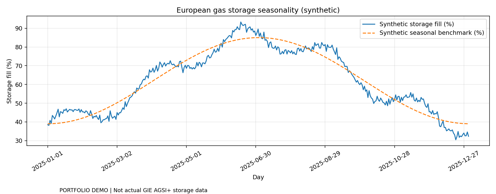

# European Gas Trading & Storage Analytics

**[▶ Launch the interactive Streamlit demo](https://european-gas-storage-trading-knmug4zwhdgjtl9fgnfppf.streamlit.app)** — try the dashboard in your browser, no Python installation needed.

**Explore:** [Python source](src/) · [Streamlit app code](app.py) · [Unit tests](tests/) · [Chart preview](assets/gas-preview.png) · [Run instructions](#quick-start)

*The default example uses synthetic inputs; this is educational research, not live trading or an investment recommendation.*


**Storage scarcity, seasonal TTF spreads and lagged-signal backtesting in Python.**



> Independent **educational** gas-trading research. The provided storage levels and TTF forwards are **synthetic**, **not** actual GIE AGSI+ / ICE market observations. This is a unit-spread mark-to-market illustration, **not investable trading performance**.

## Research question

Can seasonal European storage deviations help explain changes in the TTF winter/summer spread?

- `storage_deviation_pp = storage_pct − seasonal_reference_pct`
- `winter_summer_spread = TTF_winter − TTF_summer`, €/MWh
- `signal[t] = +1` for scarcity (storage below norm by more than threshold)
- `signal[t] = −1` for excess storage (above norm)
- `signal[t] = 0` otherwise
- **One-period lag**: `position[t] = signal[t−1]`
- Model `P&L[t] = position[t] × (spread[t] − spread[t−1]) − trading_cost × abs(position[t] − position[t−1])`

The lag prevents using *future* storage in the **position**. However, daily settlement marks and execution prices are approximated; the project does not implement a specific contract roll calendar or realistic spread execution. A robust extension would pair dated AGSI+ releases with timestamped TTF tradeable bids/asks and gas-year contract IDs.

## Features

- Relative storage fill vs configurable historical seasonal reference.
- TTF winter/summer forward-spread time series.
- Configurable long/short/flat signals, turnover cost, daily P&L per MWh-equivalent spread.
- Cumulative P&L graph and downloadable positions and data.
- CSV upload for independently sourced historical observations.

## Quick start

```bash
python -m venv .venv
# Windows: .venv\Scripts\activate
# macOS/Linux: source .venv/bin/activate
python -m pip install -e '.[dev]'
streamlit run app.py
```

CLI: `python examples/run_demo.py`  
Tests: `python -m pytest -q`

## Data format

See `data/gas_market_example.csv`:

```text
date,storage_pct,seasonal_reference_pct,ttf_winter_eur_mwh,ttf_summer_eur_mwh
```

The **seasonal_reference_pct** is an ex-ante historical benchmark and must be formed using **only information available before each observation**. Building this from full-sample current-year data introduces lookahead bias. For real data, consult [GIE AGSI+](https://agsi.gie.eu/) for storage and an appropriately licensed TTF forward source for contract-specific marks. No API key is needed for the supplied synthetic demo.

## Limitations

Position notional is one spread unit; €/MWh here is **not € of account equity**. Contract roll, seasonal settlement, liquidity, actual bid/ask, slippage, collateral and margin, financing, expiry, risks and timestamp alignment are omitted. Strategies should be evaluated out-of-sample with identified contracts before any performance claims.

License: MIT.

## Optional REAL GIE AGSI storage history

`src/gas_storage/historical.py` adds an optional downloader for **GIE AGSI** EU aggregate storage, using a personal `GIE_API_KEY` environment variable and authenticated paginated requests. GIE API data are free but require registration and source attribution **GIE AGSI**. The helper `ex_ante_seasonal_reference()` uses only past calendar years for the same day of year. **GIE storage ALONE is not a tradable TTF spread**; to run the strategy on historical markets, merge by correct *availability timestamp* with licensed TTF winter and summer contract-specific forward marks. No GIE secret or external historical data is shipped in this repository. See [GIE data usage rules](https://iip.gie.eu/data-usage).
